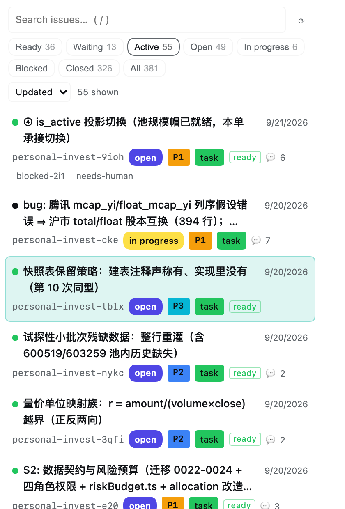
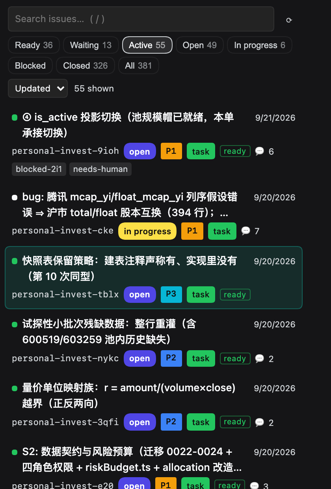
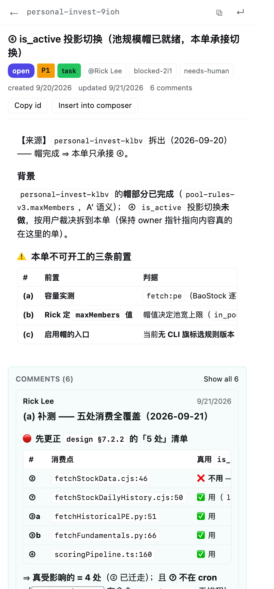
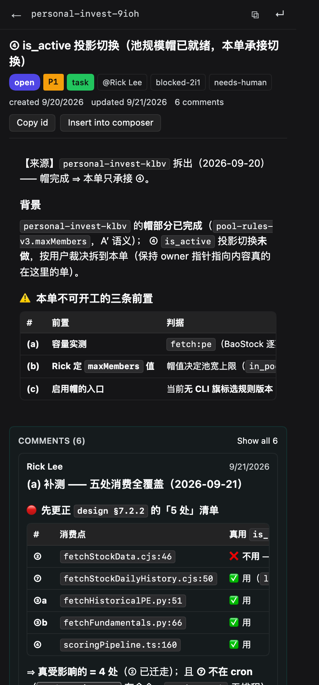
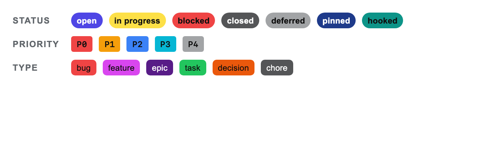
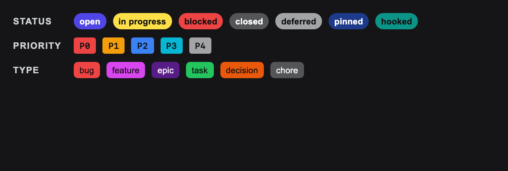
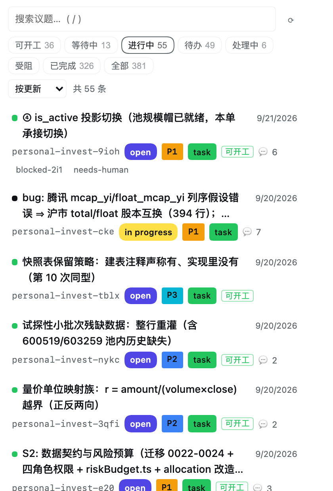

<div align="center">

# dsh-beads-viewer

**在 DeepSeek Harness 右侧栏浏览 [Beads](https://github.com/Dicklesworthstone/beads) 议题** —— 终端 [`bv`](https://github.com/Dicklesworthstone/beads_viewer) 的浏览器版。

[](https://www.npmjs.com/package/dsh-beads-viewer)
[](./LICENSE)
[](./README_ZH.md#%E6%B5%8B%E8%AF%95)

🌏 [English](./README.md) · [**中文**](./README_ZH.md)

</div>

<div align="center">

| 浅色 Light | 深色 Dark |
| --- | --- |
|  |  |

</div>

---

## ✨ 功能

| | |
| --- | --- |
| **🗂️ 与文件页并列的页签** —— 在右侧栏注册 `beads` 页签类型，可停靠、分栏、浮动；切换页签后筛选、搜索、滚动位置都还在。 | **🎨 颜色徽章** —— 每行三个实心徽章：状态、优先级、类型，各占一种形状与色系。文字颜色由底色亮度推导，永远可读；两种徽章不会撞色（ΔE ≥ 25，测试强制）。 |
| **📏 等高行** —— 每行固定三个行框（`calc(3 * 1lh + padding)`），列表像网格一样可扫读；超长标题按容器宽度截断，标签轨道即使为空也保留。 | **🖱️ 悬停即高亮** —— 平时无底色，指针所在行染上青色。一种颜色对 `transparent` 混色，明暗两个主题都成立。 |
| **🔍 可开工与受阻** —— 来自 `bd ready` 的「可开工」、被未关闭前置挡住的「等待中」，加上状态徽章的实时计数、搜索框（`/` 聚焦）与排序。 | **📝 精修 Markdown** —— 标题、嵌套与任务列表、表格、围栏代码、引用与强调，由内置渲染器完成；长评论线程从最新的评论开始展开。 |
| **🔗 可点击的引用** —— 正文中出现且真实存在的项目文件，点击即在文档预览中打开；议题 id 可直接跳转。目标不存在时保持纯文本。 | **🧾 id 顺手可用** —— `⧉` 复制，`↵` 插入输入框光标处，一次可撤销的编辑。 |
| **🌓 三个维度跟随主题** —— 宿主的字号设置、字体选择、界面语言（中/英）都会生效。 | **🧩 次要内容退后** —— design、notes、验收标准与评论区带一层淡底色；正文描述保持在最前。 |

<details>
<summary><b>更多截图</b></summary>

**议题详情** —— 描述在前，次要内容带淡底色：

| 浅色 | 深色 |
| --- | --- |
|  |  |

**完整徽章色板**，两种主题都做过对比度校验：

| 浅色 | 深色 |
| --- | --- |
|  |  |

**界面语言跟随宿主设置：**



</details>

## 🚀 安装

```sh
# 从 registry 安装
dsh plugin --profile <name> add dsh-beads-viewer

# 或从本地检出安装（profile 条目会 link 到这个目录）
dsh plugin --profile <name> add /path/to/dsh-beads-viewer
```

然后**重启 Harness**，让新的客户端 bundle 加载（浏览器硬刷新也能取到更新的 bundle）。页签出现在右侧栏的新建页签引导里。

**link 安装**在下次加载时直接生效，无需重装；registry 安装是普通包，升级需要再次运行 `add`。

<details>
<summary><b>依赖</b></summary>

- **`bd` CLI**，装在运行 Harness 的机器上。Host 会先找 `PATH`，再找 Homebrew 与 Go 的常规安装位置；`brew install beads` 即可。
- **一个有 Beads workspace 的项目**。面板用 `bd where` 询问会打开哪个 workspace，所以子目录、git worktree、`BEADS_DIR` 覆盖都与 `bd` 本身的行为一致。

两者缺其一时，面板会在面板内说明缺哪个，并附上 `bd` 给出的原因。

</details>

<details>
<summary><b>常见问题</b></summary>

| 现象 | 原因与处理 |
| --- | --- |
| **页签显示 HTTP 404，但搜索栏和筛选器还在** | 客户端是静态资源所以照常渲染，但数据路由没有注册——插件比宿主的 web 服务先激活。1.0.0 已改为等待服务就绪；旧版本遇到请重启 Harness。 |
| **面板字体或字号不跟随宿主外观设置** | 同上：运行中的客户端 bundle 比页面旧。硬刷新（Cmd/Ctrl+Shift+R）。面板的字号来自 `--dsh-content-font-size`，字体来自宿主字体变量。 |
| **找不到 `bd`** | 先安装（`brew install beads`），或确认它在运行 DSH 的进程的 `PATH` 上。 |
| **"This project has no Beads workspace"** | 在项目里跑 `bd init`，或用 `BEADS_DIR` 指向已有的 workspace。面板会原样给出 `bd` 的原因。 |
| **以前能打开的 workspace 现在提示迁移** | 旧的 Beads workspace 需要由 `bd` 自行迁移；面板会原样显示 `bd` 给出的指令，而不是猜测。 |
| **有序列表的数字比旁边的圆点宽** | 这是有意的：数字需要更宽的槽（`2.35em` 对 `1.9em`），两种列表的文字起点一致。 |

</details>

## 🔧 如何读取 tracker

Host 半只提供一条只读路由 `GET /beads-viewer/api`：

| 参数 | 返回 |
| --- | --- |
| `?cwd=<dir>` | 全部议题（精简行）、状态计数、状态词汇表，以及每条议题的可开工状态 |
| `?cwd=<dir>&action=issue&id=<id>` | 完整议题、评论，以及两个方向的依赖 |
| `?cwd=<dir>&action=files&paths=<换行分隔>` | 这些路径中哪些存在、各自的位置 |

`?force=1` 绕过四秒的列表缓存。三条刻意的原则：

- **shell 调用 `bd`，不读数据库文件。** Beads workspace 可能是 Dolt 服务也可能是 SQLite 文件，且 schema 随 `bd` 版本变动。`bd --json` 是在两者之间都保持正确的接口——workspace 太旧时，`bd` 会给出迁移指引，面板原样展示而不是猜测。
- **只读。** 所有读取都经过同一个 `readBd` 辅助函数，它把 `bd --readonly` 放在最前，因此这个保证是结构性的而非逐次调用的小心——有测试断言该参数在 argv 上。没有任何路由会改动数据。
- **只回答自己。** 路由拒绝非回环请求，`?cwd=` 必须是存在且（或其父目录）含 `.beads` 的目录；该目录随后作为每次 `bd` 调用的工作区，请求无法把 `bd` 指向任意目录。

## 📁 布局

```
index.js            Host 半：只读路由与 bd 调用
client.js           Client 半：侧栏页签、面板与 Markdown 渲染器
cordis.patch.yml    挂载 host 条目的 bundle patch
locale/{en,zh}.json 插件管理器里的标题与描述
icon.svg            面板图标
test/               五个套件，103 项检查
docs/               本 README 引用的截图
```

<details>
<summary><b>🧪 测试</b></summary>

```bash
npm test
```

五个套件，103 项：

| 文件 | 覆盖 |
| --- | --- |
| `test/host.test.mjs` | 辅助函数、handler 的错误分支，以及真实的 `bd` workspace（缺 `bd` 时跳过） |
| `test/client.test.mjs` | Markdown 解析器、路径提取、文件地址、列表缩进 |
| `test/activation.test.mjs` | 对假 context 运行 `apply`，包括没有右侧栏的 profile，以及语言切换 |
| `test/render.test.mjs` | 用真实 React 渲染 Markdown、徽章对比度、行距、区块底色 |
| `test/panel.test.mjs` | 面板各状态——列表、点行后的详情、失败卡片、传输错误、语言切换 |

后两个渲染的是**实际交付的组件树**，因此崩溃、错误 prop 或 hook 顺序问题会让套件失败，而不是把面板渲染成空白。

**可开工状态不在这里计算。** `bd ready` 才是规则的拥有者；在插件里重新推导，`bd` 一改规则就会漂移。该命令失败时负载会标成 `unavailable`，面板就不显示可开工的筛选——「没有可开工的」与「问不出来」是两种不同且都需要区分的状态。

</details>

## 📋 已知限制

- 每次刷新要开两个 `bd` 进程（列表 + ready；380 条议题约 0.8s）；列表缓存四秒，窗口重新获得焦点时刷新，Refresh 控件只为它自己的那一次请求绕过缓存。
- 列表上限 2000 条议题，单个议题上限 200 条评论。
- 面板是**查看器**。创建、编辑与关闭议题仍归 `bd` 和 agent——那是唯一能准确报告改动了什么的地方。
- Markdown 由小型内置渲染器完成，不是完整的 CommonMark 实现：覆盖议题正文实际用到的部分，并在其上加了文件与议题链接。

## 📄 许可

[MIT](./LICENSE)

